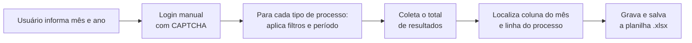

# Coletor de Dados Semiautomatizado

**Automação em Python que reduziu a coleta de dados de processos de ~1 semana para ~3 minutos.**

Desenvolvido durante meu estágio na IPS Serra e usado pela equipe para atualizar a planilha corporativa de acompanhamento de processos.


---

## O problema

Todo mês, a equipe precisava consultar no sistema IPS a quantidade de processos de cada tipo, aplicando filtros de palavras-chave e período, e copiar os totais manualmente para uma planilha em rede. Com vários tipos de processo e várias combinações de filtros, o trabalho levava cerca de **uma semana**.

## A solução

Um script que faz todo esse caminho sozinho: pesquisa cada tipo de processo, coleta os totais e grava direto na planilha. O usuário só faz o login e informa o mês e o ano.

| | Antes | Depois |
|---|---|---|
| Tempo da coleta | ~1 semana | **~3 minutos** |
| Processo | Manual, repetitivo | Automatizado |
| Risco de erro de digitação | Alto | Eliminado na transcrição |

## Como funciona



1. **Período dinâmico:** a partir do mês e ano informados, o script gera a data inicial, a data final e o horário completo do período.
2. **Login manual:** o sistema usa CAPTCHA, então o login fica com o usuário. Todo o resto é automático.
3. **Consultas automatizadas:** o script percorre uma lista configurável de tipos de processo, preenchendo os campos de resumo, os operadores lógicos e o período.
4. **Coleta:** lê o total de resultados de cada pesquisa.
5. **Atualização da planilha:** com OpenPyXL, localiza a coluna do mês e a linha de cada processo, troca o valor antigo pelo novo e salva o arquivo na rede.

## Decisões técnicas

- **Login manual em vez de tentar burlar o CAPTCHA:** é mais simples, mais confiável e respeita a segurança do sistema.
- **Busca de coluna e linha pelo conteúdo, não por posição fixa:** a planilha pode ganhar linhas ou colunas sem quebrar a automação.
- **Tipos de processo configuráveis:** dá para incluir um tipo novo sem mexer na lógica do script.

## Tecnologias

- **Python 3.11+**
- **Selenium**: automação do navegador
- **OpenPyXL**: leitura e escrita da planilha .xlsx
- **ChromeDriver**

## Como executar

### Requisitos

- Python 3.11 ou superior
- Google Chrome instalado
- ChromeDriver compatível com a versão do Chrome
- Acesso à rede corporativa e permissão de leitura e escrita na pasta da planilha

### Instalação

```bash
git clone https://github.com/AA-MOREIRA/Coletor-de-dados-semi-automatizado.git
cd Coletor-de-dados-semi-automatizado
python -m venv venv
source venv/bin/activate        # Windows: venv\Scripts\activate
pip install -r requirements.txt
```

### Configuração

Ajuste no arquivo de configuração:
- o caminho da planilha na rede;
- a lista de tipos de processo, com as palavras-chave e os operadores de cada um.

### Execução

```bash
python main.py
```

1. Informe o mês e o ano quando o script pedir.
2. Faça o login no navegador que abrir (incluindo o CAPTCHA).
3. Aguarde: o script faz as consultas e atualiza a planilha sozinho.

## Observação

Este repositório não inclui dados, credenciais nem endereços internos da IPS Serra. As configurações usadas em produção ficam fora do código.

## Autor

**Allan Augusto Moreira de Oliveira**
[LinkedIn](https://linkedin.com/in/allan-moreir4) · [GitHub](https://github.com/AA-MOREIRA)
